<div align="center">

# Is It Just Me?

**One calm page that tells you, in plain words, whether the tools you work with are up or down: Teams, Zoom, Slack, AWS, Azure, GCP, Azure DevOps, GitHub, Jira, Workday and 30+ more.**

[**Open the live site →**](https://codemitvishal.github.io/is-it-just-me/)


</div>

---

## The story

The Friday before last I was invited to a meeting, and nobody showed up.

I'm the kind of person who waits. I gave it 30 minutes and used the time to get other work done. Afterwards I kept wondering: *was everyone else stuck too, was the meeting tool down, or was it just me?*

Answering that took far too long. Every company has its own status page, each one looks different, and most are written for engineers. Microsoft doesn't even publish a public live status for Teams. Developers, managers and HR people all rely on a dozen of these tools every day, but nobody puts them on one screen in words everyone understands.

**So I built that screen.** You open one page and get one sentence: "Yes, Zoom is down. It's not you." There are no accounts, no ads, no tracking, and it costs nothing to run.

## The goal

| | |
|---|---|
| **Answer first** | Type a tool and get a sentence back, such as "No, GitHub is working" or "Yes, Snowflake is down", plus what to do next |
| **Everyone understands it** | Plain words, a different shape *and* colour for each status, and a high-contrast theme and easy-to-read font |
| **One screen for every team** | Meetings and chat, developer tools, cloud, AI, HR and hiring, and everyday work tools |
| **Follow what you use** | Tap 🔔 to get a browser notification while the page is open, or use the free RSS feed when it's closed |
| **Private by design** | No cookies, no analytics, nothing loaded from other websites |
| **Free forever** | Runs entirely on free GitHub features: Actions and Pages |

## What it looks like

- **The answer on top:** for example "4 tools have problems right now", with a search box: *"Which tool isn't working for you?"*
- **"Meeting didn't start?"** One tap checks every meeting tool. That button exists because of the story above.
- **Official logos** taken from each company's own status page, so you recognise tools instantly.
- **Display options:** three themes (Light · Dark · High contrast), three fonts (Modern · Easy to read · Friendly) and three languages (English · Deutsch · हिन्दी).
- **Phone first:** two-line cards, swipeable filters and a bottom-sheet for details. It works down to 320px wide screens.

## How it works

<p align="center">
  
</p>

```
43 status pages ──(once every 15 min · Google Apps Script timer)──► GitHub Pages (gh-pages, CDN-cached)
                                                                    ▲        ▲        ▲
                                                         browser 1 ─┘        │        │
                                                         browser 2 ──────────┘        │
                                                         browser N ───────────────────┘
```

1. **Every 15 minutes a timer on Google Apps Script runs the collector *once*.** It reads the public status pages of 43 services, in 9 formats such as Statuspage, AWS Health, Azure RSS, Google incidents and Slack. This is free and runs on Google's servers; no PC needs to be on and no GitHub Actions are needed.
2. **The collector turns every format into one simple status** (working · some problems · down · maintenance · can't check), remembers when it changed, and writes `status.json`, the history and an RSS feed per service to the `gh-pages` branch, all in **one commit**.
3. **GitHub Pages publishes it** with its built-in build and serves it through its CDN cache (~10 minutes).
4. **Every visitor's browser reads only that cached copy** and checks again every 5 minutes. Browsers never contact the companies. However many people open the site, the status pages are asked exactly once per update.

### Code architecture (onion layers)

```
   ┌─────────────────────────── main.js (wires everything) ───────────────────────────┐
   │  ┌──────────── adapters · infrastructure · ui · i18n (talk to the world) ──────┐  │
   │  │  ┌──────────────── application (use cases + ports) ──────────────────────┐  │  │
   │  │  │  ┌──────────────── domain (pure rules, no I/O) ───────────────────┐   │  │  │
   │  │  │  │  status · catalog · history · search · summary · validation    │   │  │  │
   │  │  │  └────────────────────────────────────────────────────────────────┘   │  │  │
   │  │  └────────────────────────────────────────────────────────────────────────┘  │  │
   │  └───────────────────────────────────────────────────────────────────────────────┘  │
   └───────────────────────────────────────────────────────────────────────────────────────┘
```

The collector (`collector/`) and the website (`web/js/`) both use these layers, and they share no code. They meet only at `status.json`, whose format is documented in [docs/DATA_CONTRACT.md](docs/DATA_CONTRACT.md). An architecture test fails the build if an inner layer ever imports an outer one.

See **[docs/ARCHITECTURE.md](docs/ARCHITECTURE.md)** for the full map and a "where do I change X?" table.

## Quick start

Requires Node 20 or later. There's nothing to install.

```bash
npm test          # 66 tests: providers, domain, i18n, contract, architecture, security, Apps Script
npm run collect   # local test data only → web/data/ (never deployed)
npm run dev       # preview at http://127.0.0.1:8080
npm run deploy    # deploy website code to gh-pages (keeps the cloud's status data)
npm run build:gas # rebuild cloud/apps-script/Code.gs after changing collector/ or config/
npm run icons     # refresh official icons from each status page (review the diff)
```

## Project structure

```
config/services.json   the 43 services we watch (add or remove one here)
collector/             domain · application · adapters · infrastructure (runs in Node and, bundled, in Apps Script)
cloud/apps-script/     Code.gs (generated bundle + runtime.js) · appsscript.json: the 15-minute cloud updater
web/                   the static website: index.html · privacy.html · css/ · js/ · icons/ · fonts/
tests/                 node:test + saved real provider responses (fixtures/)
docs/                  ARCHITECTURE.md · DATA_CONTRACT.md · assets/architecture.svg
tools/                 dev-server.js · deploy-site.js · build-apps-script.js · fetch-icons.js
```

## Security, privacy and EU law

I built it to be safe and lawful by default. Full details are in [SECURITY.md](SECURITY.md) and on the site's [Privacy & legal page](https://codemitvishal.github.io/is-it-just-me/privacy.html).

| Topic | How it's handled |
|---|---|
| **GDPR** | No personal data is collected. The privacy notice (English + German) explains hosting by GitHub Pages (Art. 6(1)(f), EU–US Data Privacy Framework), your rights (Art. 15–21) and complaints (Art. 77). |
| **Cookies / ePrivacy / TDDDG § 25** | No cookies. Local storage keeps only your own choices (theme, font, language, followed services), which counts as strictly necessary, so **no consent banner is needed**. Every key is listed on the privacy page, and a test makes sure that list stays complete. |
| **Third parties** | None. Fonts and icons are self-hosted, which avoids the 2022 Munich "Google Fonts" problem. No CDN, analytics or ads. Browsers never contact the status providers (`connect-src 'self'`); only the cloud updater does, once per update. |
| **Trademarks** | Logos only identify each service and come from that company's public status page. No affiliation is implied, and rights holders can request removal. |
| **Accessibility (EAA / WCAG 2.2 AA)** | Full keyboard support, screen-reader labels, status shown by shape and text, a high-contrast theme, an easy-to-read font for low vision (Atkinson Hyperlegible) and reduced motion. |
| **Web security** | A strict Content-Security-Policy (same origin only, no inline code), all text rendered with `textContent`, https-only links, `no-referrer`, and [`security.txt`](web/.well-known/security.txt). |
| **Supply chain** | Zero npm dependencies. The cloud updater's GitHub token is fine-grained: this one repo, "Contents" only. It's stored in Apps Script's private script properties. The Apps Script asks for only 2 permissions. |

> Not legal advice. This is a private, non-commercial project. If you run a commercial copy in Germany, you may also need an Impressum (§ 5 DDG).

## Cloud updater (Google Apps Script) — free, no PC, no GitHub Actions

| Job | Done by |
|---|---|
| Fetch the 43 status pages every 15 min | **Google Apps Script** time-driven trigger (`cloud/apps-script/Code.gs`) |
| Store the data | One commit to the `gh-pages` branch through the GitHub API (`data/`, `feeds/`) |
| Publish the website | GitHub Pages' built-in build (still works when Actions can't run) |
| Deploy code changes | `npm run deploy`: copies `web/` to `gh-pages` and **keeps** the cloud's data |

### One-time setup (about 5 minutes)

1. **Create a GitHub token** at github.com → Settings → Developer settings → **Fine-grained tokens** → *Generate new token*:
   - Repository access: **Only select repositories →** `is-it-just-me`
   - Permissions: **Contents → Read and write** (nothing else)
2. **Create the script** at [script.google.com](https://script.google.com) → *New project* → name it `is-it-just-me updater`.
3. **Paste the code:** replace everything in `Code.gs` with [`cloud/apps-script/Code.gs`](cloud/apps-script/Code.gs).
   - *Optional, recommended:* open Project Settings, tick **Show "appsscript.json"**, and paste [`cloud/apps-script/appsscript.json`](cloud/apps-script/appsscript.json). This limits the script to 2 permissions.
4. **Store the token:** Project Settings → **Script properties** → *Add* → name `GITHUB_TOKEN`, value = your token.
5. **Run `run` once** (function dropdown → `run` → ▶). Allow the permissions it asks for, then check the execution log for *"Published 43 services …"*.
6. **Run `setup` once.** This installs the 15-minute timer. To stop it, run `teardown`.

After changing `collector/` or `config/services.json`, run `npm run build:gas` and paste the new `Code.gs` again. A test fails if you forget to rebuild.

### With GitHub Actions (optional)

If Actions is available on your account, the workflow in `.github/workflows/status.yml` does everything in the cloud: tests first, then collect and deploy, every 10 minutes. To use it:

1. Enable it on the Actions tab, and remove the Apps Script timer (`teardown`).
2. Set **Settings → Pages → Source** to **GitHub Actions**.

GitHub pauses scheduled workflows after ~60 days without repo activity.

## Known limits

- **Microsoft Teams, Microsoft 365, Webex and Workday** publish no public live feed, so they honestly show "Can't check" with a link to the official page.
- **Data can lag** up to ~25 minutes: 15 minutes between updates plus up to 10 minutes of GitHub Pages caching. That's the price of every visitor sharing one cached copy. The page warns when data is more than 45 minutes old.
- **Notifications** work only while the page is open. Use the RSS feeds for alerts when it's closed.

## Credits and license

Code: [MIT](LICENSE). Fonts: Inter, Atkinson Hyperlegible Next, Nunito and Noto Sans Devanagari ([SIL OFL](web/fonts/OFL.txt)). Logos are trademarks of their owners, and the project isn't affiliated with any company shown.
